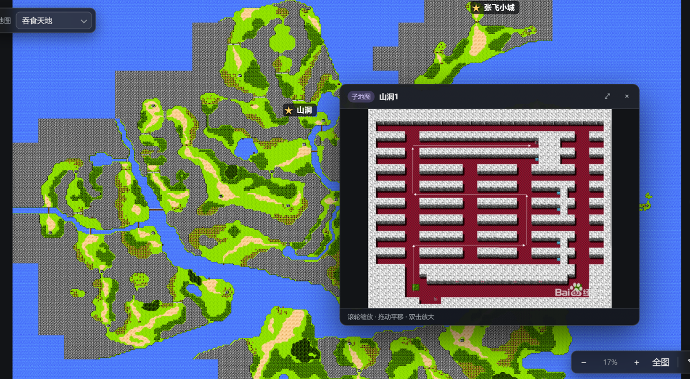

# 作者信息
作者：Curpond[qq1713610444]  
贡献者
- 暂无

# 项目介绍
这是一个由图片构成的地图查看器。旨在帮助一些小的游戏，可以快速的查看其地图，还可以在地图上自定义添加标记，支持地图中套子地图，可以方便的显示地图信息。


# 地图阅读器（MapReader）

超大图片的「模拟地图」查看器：滚轮以鼠标位置为基准缩放、按住拖动平移、双击缩放，缩放到哪都不会把图片拖丢。支持 `maps/` 目录下放多张地图，用左上角下拉框切换；支持在地图上打标签（城名、说明、Markdown 信息），标签自动存档。

现有地图：`maps/吞食天地.png`（5516 × 4636）。

## 运行（推荐双击）

直接双击项目根目录的 **`start.bat`**：

- 自动扫描 `maps/` 生成地图清单
- 检测到源码有改动就自动编译
- 起本地服务器并**自动打开浏览器**
- **关闭弹出的黑窗口 = 停止服务**；也可以在 `stop.bat` 里一键停掉（窗口丢了时用）
- 重复双击 `start.bat` 不会开第二份服务，会直接复用已在跑的那个

命令行方式（等价）：

```bash
npm start          # = node scripts/start.mjs，默认 http://127.0.0.1:5173
npm run serve      # 只起服务、不自动打开浏览器
npm run stop       # 停止由 start 启动的服务
npm run build      # 单次编译
npm run watch      # 监听模式
```

> ES Module 不能通过 `file://` 打开，必须走 http（所以不能直接双击 `index.html`，要双击 `start.bat`）。
>
> Windows 上如果 `.ps1` 被执行策略禁用，全局命令请用 `tsc.cmd -p tsconfig.json`，不要用 `tsc`。

## 加新地图

把图片丢进 `maps/`，然后重新双击 `start.bat`（会自动重新生成清单）：

```bash
npm run maps       # 也可以手动重新扫描 maps/ 生成 maps/manifest.json
```

- 下拉框里的名字就是**文件名（去掉扩展名）**，例如 `maps/吞食天地.png` → `吞食天地`；想改名就重命名文件。
- 支持 `.png .jpg .jpeg .webp .gif .avif .bmp`，按拼音排序。
- 浏览器无法列目录，所以必须由清单文件 `maps/manifest.json` 提供数据（它已提交进仓库，静态部署时直接用）。

## 地图标签

按工具条最右边的 **✎**（或按 `E`）进入编辑模式：

- **点地图空白处** → 在该位置新建一个标签，右侧弹出编辑面板
- 点已有标签 → 选中并编辑；**按住拖动**可以微调位置
- 面板里可以改：名称、形态（★ 五角星 / 纯文字）、颜色、**显示时机**、Markdown 信息
- 面板下方列出当前地图的所有标签，点一下就跳过去
- 删除：选中后点「删除」，或按 `Delete`；`Esc` 关闭面板 / 退出编辑

查看模式下的标签：

- **鼠标悬停** → 气泡预览（标题 + 信息前几句）
- **点击** → 右侧固定信息卡，Markdown 会渲染成标题、列表、表格

**显示时机**用来解决「标签太多糊成一片」：每个标签可以单独设阈值——
「始终显示」，或「放大 2×/4× 才出现」，也可以直接填任意阈值数字。
阈值按地图缩放倍数比较（`0` 表示始终显示，数值越大越晚出现）。

## 子地图（洞口 / 城镇内部）

给标签挂一张子地图，就能一层层钻进去看：

1. 把子图放进 `maps/sub/`（这个目录里的图**不会**出现在顶部下拉框）。
2. 重新双击 `start.bat` 刷新清单。
3. 编辑标签 → 在「子地图」里选上它。

进入方式和返回：

| 操作 | 效果 |
| --- | --- |
| 右键标签 →「进入此地图」 | 主容器切换到子地图（面包屑出现：`吞食天地 › 山洞`） |
| 右键标签 →「在浮窗中预览」 | 右下角开小窗显示子图，大地图保持在原地（可拖动标题栏移动、`⤢` 在主视图打开） |
| 信息卡里的「进入 山洞」按钮 | 同上，进入主视图 |
| 面包屑上的任意一级 | 跳回那一层 |
| `Esc` / `Backspace` | 返回上一层 |

- **支持多层嵌套**：山洞里的标签还能再挂「洞中洞」，一路钻下去，面包屑都记得住。
- 每层都会记住自己的缩放和位置，**返回时原样还原**，不会跳回全图。
- 子地图里同样可以打标签，数据按「相对 `maps/` 的路径」独立存档（如 `sub/山洞.png`）。
- 子图路径支持再分子目录，例如 `sub/山洞/一层.png`。

## 右键菜单

在标签上右键：

| 菜单项 | 说明 |
| --- | --- |
| 查看信息卡 | 打开右侧固定信息卡 |
| 进入此地图 | 有子地图时可用 |
| 在浮窗中预览 | 有子地图时可用 |
| 编辑此标签 | 进入编辑模式并选中 |
| 复制坐标 | 复制图片像素坐标 |
| 删除此标签 | 删除（右键删除无需先开编辑模式） |

在地图空白处右键：新建标签（编辑模式）、适应窗口、切换编辑模式、复制此处坐标。
菜单是数据驱动的（`src/contextMenu.ts`），以后加新操作只要往数组里塞一项。

### 数据存在哪

`data/markers.json`，已经在仓库里、跟着 git 一起备份：

```json
{
  "version": 1,
  "maps": {
    "吞食天地.png": [
      {
        "id": "m_abc123",
        "x": 1964.1, "y": 2318,
        "type": "star",
        "title": "洛阳",
        "color": "#ffd166",
        "minScale": 0,
        "markdown": "# 洛阳\n\n- 类型: 都城",
        "submap": ""
      }
    ],
    "sub/山洞.png": [
      { "id": "m_x", "x": 800, "y": 600, "title": "宝箱房", "submap": "sub/洞中洞.png" }
    ]
  }
}
```

- 坐标 `x / y` 是**图片原始像素坐标**（左上角原点），所以换窗口大小、换机器都不会跑位。
- `submap` 是**相对 `maps/` 的路径**（如 `sub/山洞.png`），空字符串表示没有子地图；含 `..` 的路径会被丢弃。
- 保存走本地服务器的写接口 `POST /api/markers`（`scripts/serve.mjs` 写盘），改完自动保存，面板底部会显示「已保存 时:分:秒」。
- 如果保存失败（比如把项目当纯静态站托管），面板会提示；这时可以点面板右上角的 **⭳** 下载一份 `markers.json` 备份，手动放回 `data/` 目录。
- 直接手改这个文件也可以，字段坏了会被自动纠正（颜色非法、坐标为空白等）。

## 操作

| 操作 | 效果 |
| --- | --- |
| 左上角下拉框 | 切换要查看的地图（会记住上次的选择） |
| 滚轮上下 | 以鼠标所在位置为基准放大 / 缩小 |
| 按住左键（或中键）拖动 | 平移；指针移出窗口也不会中断 |
| 双击 / Shift + 双击 | 原地放大 / 缩小 |
| `+` `-` | 以视口中心放大 / 缩小 |
| `0` | 恢复全图 |
| `E` | 进入 / 退出标签编辑模式 |
| `Delete` | 编辑模式下删除选中的标签 |
| `Esc` / `Backspace` | 关面板 / 退出编辑 / 返回上一层子地图 |
| 右键标签 | 上下文菜单（进入此地图、浮窗预览、编辑、复制坐标、删除） |
| 触控板捏合 | 以手势位置缩放 |

## 结构

```
start.bat             双击启动（自动编译 + 起服务 + 开浏览器）
stop.bat              双击停止
index.html            页面骨架：视口 + 地图选择 + 面包屑 + 加载态 + 提示 + 工具条
css/style.css         页面样式（组件关键样式是内联的，不依赖它）
src/mapReader.ts      地图查看器组件（缩放/平移，无框架依赖，纯 DOM）
src/mapViewport.ts    一个「地图视图」= 查看器 + 标签层 + 导航栈（主视图与浮窗共用）
src/markerStore.ts    标签数据层：读取 / 防抖保存 / 备份导出
src/markerLayer.ts    标签渲染层：覆盖层、恒定尺寸、阈值可见性、拖动、右键
src/markerPanel.ts    标签 UI：悬停气泡、信息卡、编辑表单（含子地图）、标签列表
src/contextMenu.ts    通用右键菜单（数据驱动，方便加新操作）
src/submapWindow.ts   浮窗子地图预览（可拖动、可关闭、可在主视图打开）
src/markdown.ts       极简 Markdown 渲染（标题/列表/表格/引用…）
src/main.ts           应用入口：读清单、切地图、标签编排、面包屑、工具条、快捷键
scripts/start.mjs     一键启动（生成清单 → 编译 → 起服务 → 开浏览器）
scripts/serve.mjs     零依赖静态服务器 + 标签写盘接口 /api/markers
scripts/stop.mjs      停止服务
scripts/gen-maps.mjs  扫描 maps/ 生成 maps/manifest.json（含子地图清单）
maps/                 主地图图片 + manifest.json（自动生成）
maps/sub/             子地图图片（不出现在下拉框，只能从标签进入）
data/markers.json     标签数据（跟着 git 备份）
dist/                 tsc 编译产物（已在 .gitignore 中）
```

## 组件用法

```ts
import { MapReader } from './mapReader.js'

const map = new MapReader('./maps/吞食天地.png', {
    minScale: 0.02,   // 最小缩放倍数（1 = 图片原始像素 1:1）
    maxScale: 8,      // 最大缩放倍数
    wheelSpeed: 0.0016, // 滚轮灵敏度
    pinchSpeed: 0.01,   // 触控板捏合灵敏度
    fitOnLoad: true,    // 加载后自动缩放到完整可见
    constrain: true,    // 限制图片不被拖出视口（小于视口时居中）
    initialScale: 1,    // fitOnLoad 为 false 时的初始倍数
})

// 也可以晚一点再给图片，或者切换地图（同一个实例复用）
const plain = new MapReader('')
plain.load('./maps/另一个地图.png')


document.getElementById('viewport')!.appendChild(map.element)
```

### 方法

| 方法 | 说明 |
| --- | --- |
| `zoomAt(clientX, clientY, factor)` | 以某个视口坐标（通常是 `event.clientX/Y`）为基准缩放，`factor > 1` 放大 |
| `zoomBy(factor)` | 以容器中心为基准缩放 |
| `setScale(scale)` | 缩放到指定倍数（以容器中心为基准） |
| `panBy(dx, dy)` | 平移指定像素 |
| `fit()` | 等比缩放到完整显示整张地图并居中 |
| `reset()` | 回到初始视图 |
| `load(source)` | 切换/重新指定地图，自动重新 fit；同一地址会被忽略 |
| `fitScale` | 只读：整图铺满视口时的缩放倍数（「全图视角」基准） |
| `centerOn(imageX, imageY)` | 把图片上的某个像素点移到视口中心 |
| `destroy()` | 移除所有监听并卸载元素 |

### 属性

`source`（当前地址）、`scale`（当前倍数）、`position`（`{ x, y }` 图片左上角坐标）、`naturalSize`（`{ width, height }`）、`fitScale`、`isReady`、`view`（`{ x, y, scale }`）、`element`（根元素）。

### 事件

都从 `map.element` 冒泡派发：

- `mapload` — 开始加载/切换，`detail` 为 `{ source }`
- `mapready` — 图片加载完成、首帧视图就绪
- `mapchange` — 视图变化，`detail` 为 `{ x, y, scale }`
- `maperror` — 图片加载失败，`detail` 为 `{ source }`

## 实现要点

- 位移与缩放只保存在三个数值字段里（`x` / `y` / `scale`），每次合成一条 `transform` 写进 style，不从样式字符串反解析。
- 图片的 `transform-origin` 必须是 `0 0`，这样像素坐标到容器坐标是线性的：`(u, v) → (u * scale + x, v * scale + y)`。
- 以光标为基准缩放：缩放前后光标下的图片像素保持不变，即 `x' = px - (px - x) * k`。
- 拖动用 Pointer Events + `setPointerCapture`，取 `clientX/Y` 差值（而不是 `movementX/Y`）累加。
- 图片按 `naturalWidth/Height` 原样布局，不要除以 `devicePixelRatio`。
- 缩放到边界时，光标基准会让位于边界夹紧（否则会出现空白）；图片小于视口时自动居中。
- 标签覆盖层与图片共用同一条 `transform`（每帧只写一次），标签内部再 `scale(1/scale)` 反向缩放，
  所以图标和文字在屏幕上是**恒定大小**，不会跟着地图一起放大——这就是「放大后标签不会糊满屏」的原因。
- 标签坐标存图片原始像素，点击时用 `(clientX - rect.left - view.x) / view.scale` 反算，与缩放无关。
- 子地图导航用**栈**：每次离开一层先把它的 `{x, y, scale}` 存进 `views`，所以返回上一层是原样还原；
  换图、浮窗预览各自持有独立的 `MapViewport`（同一套组件、互不干扰）。

